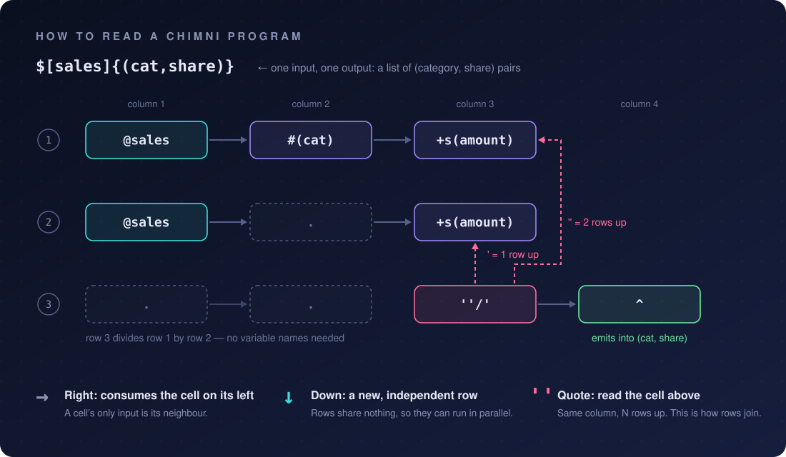

<p align="center">
  
</p>

<p align="center">
  <a href="LICENSE"></a>
  
  
  
  <a href="https://prat8897.github.io/chimni/"></a>
</p>

<h3 align="center">Most languages tell the machine <em>how</em>.<br>Chimni says <em>what flows where</em> — and the layout carries the rest.</h3>

<p align="center"><b><a href="https://prat8897.github.io/chimni/">▶ Try it in your browser</a></b> — no install; the real interpreter runs on Pyodide.</p>

---

In Sanskrit, a word's ending tells you its role in the sentence, so a lot of meaning fits in very little text.
Chimni borrows that idea for code. **Position is grammar:**

- **→ Right** means *"I consume the cell on my left."*
- **↓ A new row** means *"I'm an independent chain."*
- **' A quote** means *"read the cell above me, same column."*
- **Inputs and outputs are part of the syntax**, not something you infer from the body.

There are no loops, no temporary variables, and no names you didn't ask for. What's left is the shape of the computation.

<table>
<tr><th>Python</th><th>Chimni</th></tr>
<tr><td>

```python
def summarize_orders(orders, min_total):
    totals = {}
    for order in orders:
        name = order["customer"]
        totals[name] = totals.get(name, 0) + order["amount"]

    big_spenders = [(n, t) for n, t in totals.items()
                    if t > min_total]
    big_spenders.sort(key=lambda p: p[1], reverse=True)
    return big_spenders
```

</td><td>

```text
$[orders,min_total]{(customer,total)}
@orders  #(customer)  +s(amount)  ?>[min_total]  ~\(total)  ^
```

Take `orders` → group by customer → sum `amount` → keep totals above `min_total` → sort descending → emit.

</td></tr>
</table>

Chimni is **a real, runnable language** — a plain deterministic interpreter, no model in the loop — and every example in this repo is tested against its Python original on random inputs.

## Try it

The fastest way is the **[playground](https://prat8897.github.io/chimni/)**: pick an example, edit it, and watch every
cell's output update as you type. To run it locally:

```bash
git clone https://github.com/prat8897/chimni.git && cd chimni
pip install -e .          # no dependencies; or just run:  PYTHONPATH=src python -m chimni
```

```console
$ chimni examples/02_spenders_and_revenue.chimni \
    '{"orders":[{"customer":"asha","amount":120},{"customer":"ravi","amount":40},
                {"customer":"asha","amount":80},{"customer":"meera","amount":300},
                {"customer":"ravi","amount":25}], "min_total":100}'
([('meera', 300), ('asha', 200)], 565)
```

Add `--trace` to watch the data move through each cell:

```console
$ chimni examples/01_big_spenders.chimni '{...}' --trace
r1c1  @orders        -> [5] [{'customer': 'asha', 'amount': 120}, {'customer': 'ravi', 'amount'…
r1c2  #(customer)    -> groups(3) by customer: 'asha'x2, 'ravi'x2, 'meera'x1
r1c3  +s(amount)     -> [3] [{'customer': 'asha', 'total': 200}, {'customer': 'ravi', 'total': …
r1c4  ?>[min_total]  -> [2] [{'customer': 'asha', 'total': 200}, {'customer': 'meera', 'total':…
r1c5  ~\(total)      -> [2] [{'customer': 'meera', 'total': 300}, {'customer': 'asha', 'total':…
r1c6  ^              -> [2] [{'customer': 'meera', 'total': 300}, {'customer': 'asha', 'total':…
[('meera', 300), ('asha', 200)]
```

Or use it from Python:

```python
import chimni
top = chimni.load("examples/01_big_spenders.chimni")
top(orders, min_total=100)      # [('meera', 300), ('asha', 200)]
```

## How to read a program

<p align="center"></p>

Rows 1 and 2 don't touch each other, so a runtime is free to execute them in parallel. Row 3 joins them by *position*: `''/'` means "two rows up, divided by one row up". There isn't a variable name anywhere.

## The language at a glance

| Cell | Meaning | Python-ish equivalent |
|---|---|---|
| `$[in]{out}` | signature: inputs, and the shape of each output | `def f(in) -> out` |
| `@x` | start a row from input `x` | `for _ in x` |
| `@x(a=b)` | join input `x` where `x.a == item.b` | `JOIN … ON` |
| `#(k)` `#()` | group by field / by the item | `groupby` |
| `%(k)` | keep the first item per key | `seen = set()` loop |
| `?(f)>[v]` | filter (`> < >= <= = !=`) | `if` in a comprehension, `WHERE` |
| `?>=[90:A, 75:B, _:C]` | ladder, first match wins | `if / elif / else` |
| `*(f)` `*(a,b)` | pick field(s) | `[x["f"] for x in …]` |
| `+s +n +a +m +i` | sum / count / average / max item / min item | `sum len mean max min` |
| `+r` | running total | `itertools.accumulate` |
| `~/` `~\` | sort ascending / descending | `sorted` |
| `_l` `_u` `;w` | lowercase / uppercase / split into words | `.lower() .upper() .split()` |
| `^` `^[n]` `^[1](f)` | emit: all / first *n* / first one, then a field | `return`, `[:n]` |
| `.` | empty cell (passes data through) | — |
| `'` `''` | tie: read the cell 1 / 2 rows up in this column | — |
| `''/'` `'*2` | arithmetic on ties, numbers and inputs | — |

Full reference: [docs/SPEC.md](docs/SPEC.md) · Learn it in ten minutes: [docs/TUTORIAL.md](docs/TUTORIAL.md)

## Examples

Ten programs, each in three versions: plain Python, the **idiomatic pandas, SQL or jq** someone fluent would write,
and Chimni. All three are run against each other on hundreds of random inputs in CI, so they really compute the same
thing. Each one opens in the [playground](https://prat8897.github.io/chimni/).

| Example | What it does | Python | pandas / SQL / jq | Chimni |
|---|---|---|---|---|
| [`01_big_spenders`](examples/01_big_spenders.chimni) | customers over a spend threshold, biggest first | [8 lines](examples/python/01_big_spenders.py) | [pandas · 6 lines](examples/compare/01_big_spenders.py) | 2 lines |
| [`02_spenders_and_revenue`](examples/02_spenders_and_revenue.chimni) | …plus total revenue, as a second independent row | [9 lines](examples/python/02_spenders_and_revenue.py) | [SQL · 6 lines](examples/compare/02_spenders_and_revenue.sql) | 3 lines |
| [`03_first_big_new_transaction`](examples/03_first_big_new_transaction.chimni) | dedupe by id, first one over a limit | [9 lines](examples/python/03_first_big_new_transaction.py) | [pandas · 5 lines](examples/compare/03_first_big_new_transaction.py) | 2 lines |
| [`04_adult_names`](examples/04_adult_names.chimni) | filter, pick, sort | [3 lines](examples/python/04_adult_names.py) | [jq · 1 line](examples/compare/04_adult_names.jq) | 2 lines |
| [`05_top_words`](examples/05_top_words.chimni) | word frequencies, top *n* | [5 lines](examples/python/05_top_words.py) | [pandas · 4 lines](examples/compare/05_top_words.py) | 2 lines |
| [`06_category_share`](examples/06_category_share.chimni) | each category's share of the total (a positional join) | [6 lines](examples/python/06_category_share.py) | [SQL · 4 lines](examples/compare/06_category_share.sql) | 4 lines |
| [`07_oldest_user`](examples/07_oldest_user.chimni) | argmax, with a clean "none" for empty input | [4 lines](examples/python/07_oldest_user.py) | [SQL · 1 line](examples/compare/07_oldest_user.sql) | 2 lines |
| [`08_top_customers_sql`](examples/08_top_customers_sql.chimni) | a `JOIN … GROUP BY … ORDER BY … LIMIT` | [9 lines](examples/python/08_top_customers_sql.py) | [SQL · 5 lines](examples/compare/08_top_customers_sql.sql) | 2 lines |
| [`09_first_overspend`](examples/09_first_overspend.chimni) | running total, first index over budget | [7 lines](examples/python/09_first_overspend.py) | [jq · 3 lines](examples/compare/09_first_overspend.jq) | 2 lines |
| [`10_grade`](examples/10_grade.chimni) | an `if / elif / else` ladder | [7 lines](examples/python/10_grade.py) | [jq · 1 line](examples/compare/10_grade.jq) | 2 lines |

### The fair comparison

Comparing Chimni with loop-and-dict Python flatters it, so here are the numbers against the tools built for the job
(comments and blank lines excluded; characters counted with whitespace squeezed; tokens are `cl100k_base`;
Chimni's line count includes its signature):

|  | Python | pandas / SQL / jq | Chimni |
|---|---:|---:|---:|
| lines | 67 | 36 | 23 |
| characters | 1,973 | 1,435 | 716 |
| tokens | 623 | 412 | 317 |

- **Most of Chimni's lead over Python disappears against the right tool.** SQL and jq are about as short as Chimni,
  and on `02`, `04`, `06` and `07` they use fewer tokens. `SELECT name FROM users ORDER BY age DESC LIMIT 1` is hard to beat.
- **pandas barely helps at this size.** It saves a few lines, but in characters and tokens it's roughly even with plain
  Python (and longer on `03`): building a DataFrame costs about what the loop saved.
- **Where Chimni differs is not length.** Output shape is part of the grammar, independent rows are visibly
  independent, and ties are deterministic. The SQL versions need an explicit `ORDER BY …, MIN(rowid)` to agree with
  the others when totals are equal; Chimni and Python keep first-seen order for free.

Reproduce with `python benchmarks/size.py` (`pip install tiktoken` for the token columns).
Whether models actually *write* Chimni more reliably than these is untested — [help measure it](CONTRIBUTING.md#good-first-contributions).

## Mistakes are caught at the grammar level

Because inputs and outputs are in the syntax, a whole class of bugs can't hide.

```console
$ cat bad.chimni
$[orders]{(customer,total,extra)}
@orders  #(customer)  +s(amount)  ^

$ chimni bad.chimni '{"orders":[{"customer":"a","amount":1}]}'
run error at row 1, col 4: output (customer,total,extra) expects 3 fields but items have 2: customer, total.
```

Checked **before anything runs**: a cell with nothing on its left, a tie pointing at an empty cell, an unknown symbol or
input name, a signature that declares a different number of outputs than the rows emit.
Checked **while running**, with row and column: missing fields (it lists the ones that exist), un-aggregated groups,
output shape mismatches, `none` where the signature doesn't allow it, division by zero.

## Why Chimni exists

1. **Layout is a better carrier of structure than names.** Variable names exist mostly to wire one step to the next.
   If "the thing to my left" is the default wiring, names only appear where a human wants documentation.
2. **Dependency should be visible.** A new row *can't* depend on the one above it unless it says so with a tie, so
   parallelism and data flow can be read off the page by a person, a compiler, or a model.
3. **Signatures are contracts.** Output shape is part of the grammar, so "I said pairs but built a set" is an error.
4. **A closed vocabulary is compilable.** There's no model in the runtime. The design hypothesis is that a small,
   regular notation is something an LLM can translate *into* reliably, while a deterministic interpreter checks and
   runs the result. That hypothesis is **not yet tested** — it's on the roadmap.

Read the longer story, including what didn't work, in [docs/DESIGN.md](docs/DESIGN.md).

## Status

Chimni is **v0.1, alpha**. It's a working interpreter for the dataflow core. It is *not* yet a general-purpose language.

**Works:** the ten examples above · static grid checks · output-shape checks · `--trace` · Python API · zero dependencies · [in-browser playground](https://prat8897.github.io/chimni/).

**Not yet:** side effects (writing to a DB, sending a message) · calling one Chimni program from another ·
user-defined cells · lazy streams (early exit currently computes everything, then stops) · nested data deeper than one
level · static shape inference (output shapes are checked when a row emits, not before).

## Roadmap

- [x] Measure token cost against Python and idiomatic pandas/SQL/jq (`cl100k_base`; other tokenizers welcome)
- [ ] `chimni translate`: Python/SQL/English → Chimni with an LLM, verified by differential testing
- [ ] A translation benchmark: can models write correct Chimni from a spec?
- [ ] Side effects with explicit ordering
- [ ] Program-to-program calls and user-defined cells
- [ ] Lazy streams, so `^[1]` really stops early
- [ ] Static shape inference
- [ ] `chimni fmt` (column aligner) and editor syntax highlighting
- [x] [In-browser playground](https://prat8897.github.io/chimni/) (Pyodide)
- [ ] Backends: compile rows to SQL / pandas

## Prior art and influences

Chimni stands on the shoulders of: **Pāṇini's Aṣṭādhyāyī** and the *kāraka* idea that endings mark roles ·
**APL, J, K, BQN, Uiua** (dense, symbolic, left-to-right) · **jq** and **Unix pipes** (each stage eats the last one's output) ·
**spreadsheets** (position is meaning) · **Befunge** and other 2D languages · **dataflow and flow-based programming**.
If you know a language we should be learning from, please [open an issue](../../issues).

## Contributing

Chimni is young, and the design is still soft — which makes this a good time to shape it.
Read [CONTRIBUTING.md](CONTRIBUTING.md), then pick something: a new cell, a new example, a sharper error message, a
benchmark, or a critique of the grammar. Design arguments are welcome and encouraged.

```bash
python -m unittest discover -s tests -v     # runs in well under a second
```

## License

[MIT](LICENSE) © 2026 Pratik Kulkarni
